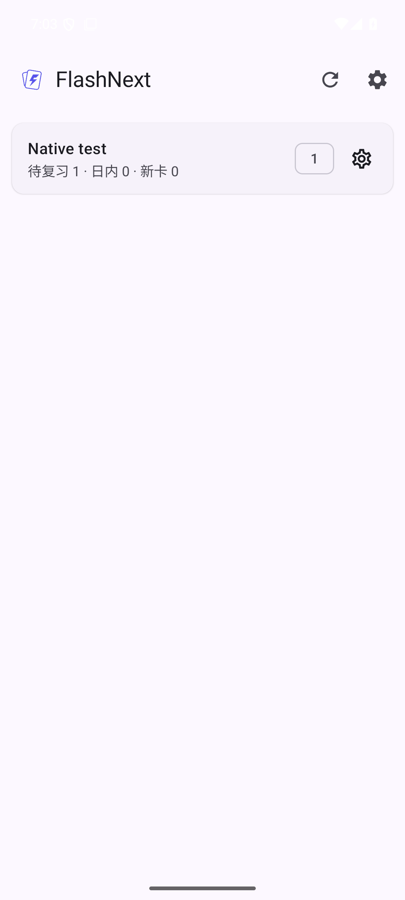
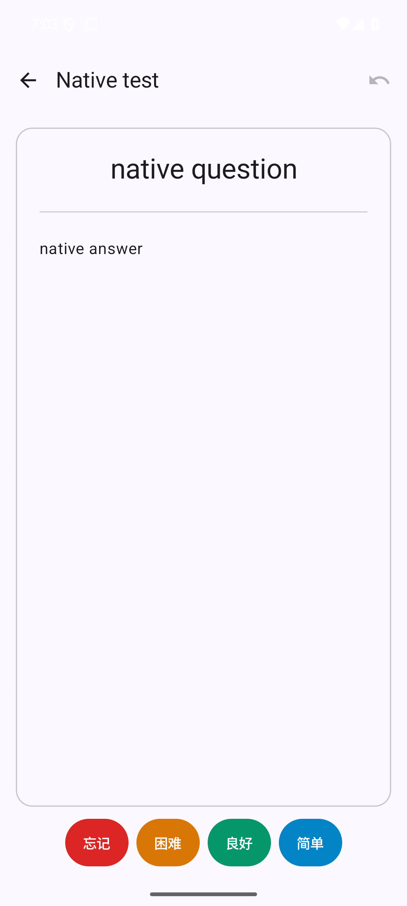
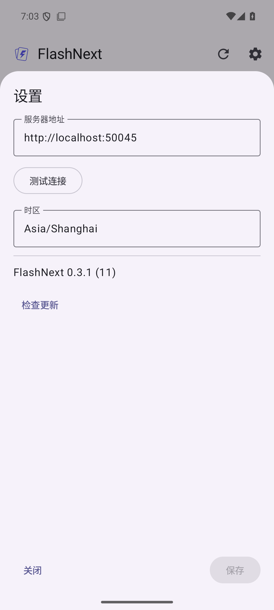
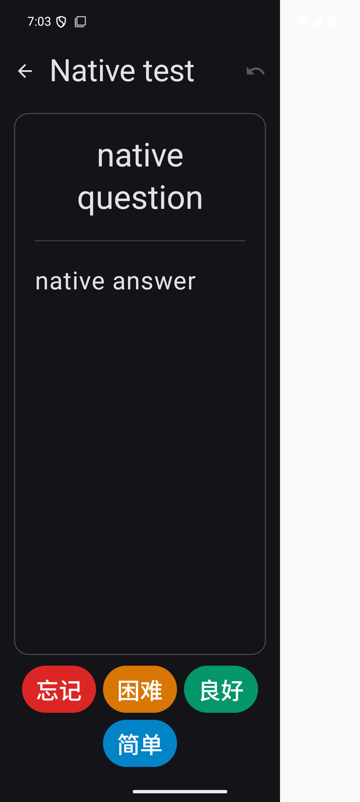

# 原生 Android 界面恢复

对照迁移前 `e3675b4` 的界面实现，修复迁移为原生 Android 时引入的展示和交互偏差。保留后续已经确认的需求：统一设置、一个保存按钮、移除时区标题与说明、复习页不显示剩余额度或底部加载条、日语不显示罗马音，以及原生应用内更新。

| 区域 | 恢复内容 |
| --- | --- |
| 首页工具栏 | 刷新、设置恢复 Material 图标，保留无障碍描述与长按提示 |
| 牌组列表 | 恢复紧凑的填充卡片、较小的标题与中性色统计、数量标记或完成图标、右侧设置齿轮 |
| 复习工具栏 | 返回恢复箭头；撤销恢复右上角图标，删除内容区额外一行文字按钮；完成后仍可撤销 |
| 评分按钮 | 恢复“忘记／困难／良好／简单”，分别使用原来的 `#DC2626`、`#D97706`、`#059669`、`#0284C7`，空间不足自动换行 |
| 卡片 | 恢复 16dp 圆角、1.25dp 浅色轮廓、正文和音标字号，维持边框位于卡面之上 |
| 自动答案与音频 | 恢复按钮上的剩余秒数；音频区显示正反面、文件数量、播放／停止图标及加载反馈，加载期间可停止 |
| 设置 | 恢复底部弹层、原字段名称和固定底部操作区；保留点击外部关闭及未保存草稿确认，不因拒绝关闭而隐藏面板 |
| 主题 | 沿用原 `#4F46E5` 种子生成的 Material Tonal Spot 亮／暗主题，不依赖设备动态配色或新增运行时库 |

撤销是旧客户端已有的功能；迁移曾将工具栏图标移到卡片内容上方，造成新增按钮的观感。本次恢复其位置和样式，未移除撤销能力。

## 验证

- 20 项 JVM 测试、Android Lint 通过。原有倒计时测试增加显示秒数、后台隐藏及答案显示后清理的检查。
- Android 15 模拟器 9 项测试全部通过：复习／完成／撤销、底部弹层内外点击和草稿保护、加载时关闭、合并保存成功／失败／仅修改服务器、320dp 宽度与双倍字体的评分按钮可用性，以及音频播放和焦点处理。
- 检查首页、亮色复习、设置及暗色大字体截图。所有写操作仅访问 loopback 测试服务。
- Material 图标使用独立 vector drawable，不引入整套图标字体或扩展图标库，来源与许可见 `assets/material-icons/`。

## 截图

