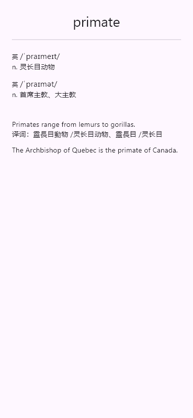

# 同步 Web 多读音展示

对应后端/Web `2e4e938` 的 [音标核对及展示说明](https://github.com/L-Chris/flashnext/blob/2e4e938/docs/study-phonetics-2026-10-21/README.md)。本次修改 App 的英语系统词卡展示，现有接口及模型已包含所需字段，无需新增接口或重复迁移词库。

## 显示规则

- 默认显示全部读音分组及其已有词性、词义和时态说明，不再折叠其他读音。单读音保持简洁，不重复说明。
- 同口音、同音标先合并词性与完整用法标签；只有标签完全相同的备选读音才以“或”合并。同词性不同词义继续分别显示。
- 按卡背默认音标优先排序，其他读音保持来源顺序。过滤非 accepted 和空白读音，去除重复音标；保留方括号窄式转写、音标内部字符及未知口音，不进行音标推断或字符转换。UK/US 分别显示“英/美”，修复原 App 误将 US 显示为英音的问题。
- 仅当多读音说明完整覆盖系统卡背的全部中文释义，且词性一致、义项逐个明确匹配时，隐藏下方重复释义。补充义项、未知词性、仅有通用词性说明、单读音均保留原释义。不推断同义词；罕见 Unicode 兼容字符无法明确匹配时也保留原释义。
- 日语与自定义正文不参与英语去重。新版后端省略 romaji，现有模型缺省为空，假名及释义继续显示。数学卡片与音频流程保持原样。

`lib/core/word_pronunciations.dart` 实现分组及保守去重；原生 `Pronunciations` 组件展示分组，`PlainCardFace` 仅在精确识别系统词卡背面时使用它们。

## 验证

```powershell
flutter analyze
flutter test
flutter test tool/verify_pronunciation_samples_test.dart
flutter build apk --release --target-platform android-arm64 --split-per-abi --build-number=6
```

离线截图检查读取 `build/qa/pronunciation-samples.json`，内容为只读取得的 8 张 `/api/cards/:id` 响应中 `data` 对象组成的数组：primate、read、permit、bow、fungi、converse、tear、desert。也可通过 `--dart-define=PRONUNCIATION_SAMPLES=<文件>` 指定快照。工具不发网络请求或提交评分，截图位于 `build/qa/pronunciations/`；Windows 使用本机 Segoe UI 与微软雅黑，其他环境可配置相应字体后复核。

覆盖 390px 普通字号及 320px 深色双倍字号，检查多读音默认展开、原释义保护与布局异常。设备未连接时，这些是 Flutter Widget 渲染验证，不代表完成手机安装或真机测试。源版本仍为 `0.1.0+3`，构建号覆盖仅用于验证包，不创建 Release 或 tag。

静态检查无问题，72 项默认测试通过；新增 14 项覆盖音标与词义对应、时态、变体与候选过滤、英美口音、窄式转写、保守去重、自定义卡背、问题面不泄露答案及日语缺省字段。8 张真实卡片共 16 次 Widget 渲染检查通过，人工检查 primate、fungi、read 和 converse 截图，未见横向溢出；大字体下长内容可纵向滚动。


