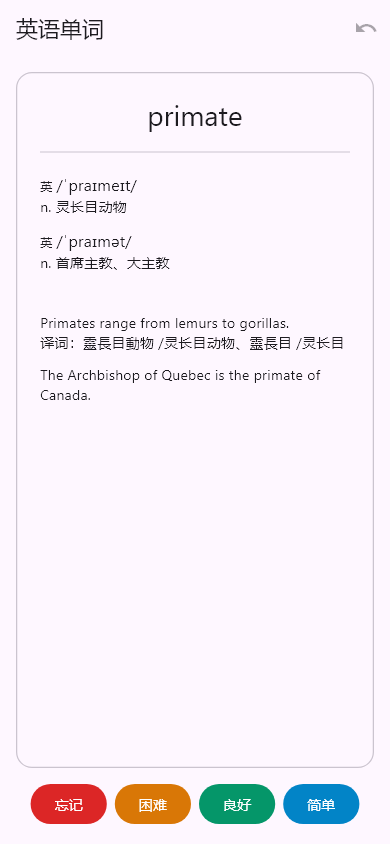

# 复习界面与切卡优化

此前每次评分都串行执行评分 POST 和完整队列 GET，并使仍在导航栈中的首页重新请求所有牌组统计。卡片之间会等待两轮网络响应，且产生额外后台计算。

## 改动

- 复习页移除“新卡剩余 / 复习剩余 / 已达限额”文字和评分时的底部线形进度条。首次加载与公式资源加载仍保留状态提示；评分中的按钮继续锁定，失败保留错误信息。
- 评分成功后从已有服务端队列中移除当前卡，直接显示缓存的下一张；不在前端重算 FSRS，也不在评分确认前切卡。首页统计改为从复习页返回时刷新一次。
- 每个快照最多连续使用 20 张或两分钟。队列耗尽、缓存到期、后台返回后的切卡、评分响应的设置版本变化、撤销时重新获取队列。
- 根据服务端评分返回的日内学习 / 重学卡到期时间记录下一次对齐期限；缓存中已有未来学习卡到期时同样重新获取队列，让已到期学习卡按服务端规则优先。只在下一次切卡时对齐，不打断正在看的卡片。
- 在进入尚未到期的提前学习卡之前重新取队列，保留后端 learn-ahead 窗口及到期顺序。没有把刚评分的学习卡插到缓存队首；其他可学卡仍优先于未到期的学习卡。
- 评分失败不消费缓存；刷新失败后的重试只重新 GET，不重发已成功的评分。撤销保留原有的强制刷新和恢复卡置顶规则。服务器切换和退出时继续忽略迟到结果。
- 卡片边框改为前景绘制，保留圆角裁切，防止不透明正文或 WebView 背景盖住四角边框。

服务端仍返回原有完整队列，本次只改客户端的消费与对齐时机，不改变接口、每日额度、FSRS 间隔或后端部署。快照存在最多两分钟 / 20 张的短暂滞后；其他设备的内容变更会在下次对齐生效。当前版本仍是在线客户端，评分 POST 的网络时间及公式本身的字体加载时间没有被消除。

## Anki 的处理

Anki 的 [CardQueues 实现](https://github.com/ankitects/anki/blob/main/rslib/src/scheduler/queue/mod.rs) 维护会话中的主队列和日内学习队列，评分后更新它们，需要时或跨学习日才重建。界面的“下一张”调用访问本地后端与本地数据库，并非每张卡都向网络服务重新下载整个队列。

本次采用短期队列缓存来减少往返，学习计划仍以服务器为准。[Anki 的 learn-ahead 说明](https://docs.ankiweb.net/manual/preferences) 要求在没有其他可学卡时才提前展示未来学习卡；本次也保留这一行为。

## 验证

```sh
flutter analyze --no-pub
flutter test --no-pub
flutter build apk --release --target-platform android-arm64 --split-per-abi --build-number=8
```

队列测试模拟服务端确认、网络失败、学习卡到期、缓存过期、设置版本变化及撤销，不对生产提交评分。连续评分 20 张的场景中，队列 GET 从原先初始加逐张刷新共 21 次降为 2 次（初始及第 20 张后补充），评分 POST 仍为 20 次。这是请求次数验证，不是宣称真实设备加载时间的固定倍数提升。

界面测试确认无额度文案或底部线形进度条、待确认期间评分按钮禁用，以及首页仅在返回后刷新。圆角边框通过不透明蓝色内容覆盖、红色边框的四角像素检查验证，避免只检查组件属性而漏掉绘制顺序问题。

源版本保持 `0.2.0+7`。构建号 8 只用于覆盖安装验证包，本次不创建新 tag 或 Release。

静态检查无问题，86 项默认测试全部通过，其中本轮新增 14 项。另完成 390px 浅色和 320px 深色大字体的原生 Widget 截图复核；不涉及生产评分或复习日志写入。

arm64 release 验证包已构建并核对：包名 `com.rethinkos.flashnext_app`、版本 `0.2.0`、构建号 `8`，签名 SHA256 与既有安装版一致。没有连接设备进行本轮真机安装。


