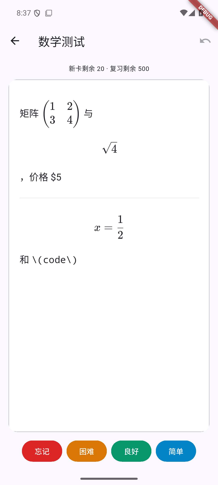

# Android 学习设置与复习展示实施记录

对应 [交接说明](../handoff/app-study-features-2026-10-20.md)。实现分支为 `feat/app-study-presentation`，源版本保持 `0.1.0+3`，本次不创建 Release 或发布 tag。

## 已实现

- 牌组卡片最右侧齿轮独立打开设置；支持限额、IANA 时区、日切点、音频自动播放、新卡立即显示、延迟显示及显式关闭（发送 null）。部分字段保存，失败保留草稿，未保存退出有确认。
- 设置与缓存按服务器、牌组隔离。FSRS 显示本牌组参数、来源、更新时间、复习日志及服务端训练门槛；支持手动启动训练和前台状态轮询。没有开放高级手动参数或日程重建。
- 可单独测试的复习会话控制器，区分手动/null、立即/0、正数延迟；就绪后计时，后台暂停，前台继续剩余时间。翻面不提交评分，评分锁避免重复请求，POST 不自动重试，完成后仍可撤销。
- `markdown_math` 经后端只读 preview 渲染，再由限制导航与资源来源的 WebView 展示。CSP 只允许每次随机 nonce 保护的固定脚本，等待 `document.fonts.ready` 和两帧绘制后通知原生就绪；卡片脚本、外部脚本和事件属性不能执行。支持服务器字体、深色模式、文字缩放与长公式滚动；失败显示原文和重试，手动答案仍可用。缓存限制为 20 条、4 MiB，单条上限 2 MiB。
- 纯文本沿用原生布局，补充日语读音、可折叠罗马音与英日义项；自定义笔记保留原文。
- 正反面音频按位置顺序播放，使用服务器根地址解析媒体 URL；处理焦点中断、后台、切卡、退出、迟到回调与失败后手动重试。焦点申请/释放顺序执行，避免上一段的释放覆盖下一段申请。
- Debug/Profile 安装固定使用独立包名 `com.rethinkos.flashnext_app.debug`，名称为“FlashNext 测试”。正式包名与签名保持兼容，测试包不会覆盖日常应用。

## 安装包体积

本地签名 release 构建测量（十进制 MB）：

| 产物 | 字节 | MB |
| --- | ---: | ---: |
| 通用 APK | 57,520,376 | 57.52 |
| arm64-v8a | 20,908,738 | 20.91 |
| armeabi-v7a | 18,399,278 | 18.40 |
| x86_64 | 22,392,462 | 22.39 |

通用包同时携带三套原生引擎，是体积的主要来源；卡片音频不打包在 APK 中。普通手机使用 arm64 包减少约 64%。Flutter 日志按 MiB 显示约 54.9 → 19.9 MB。

现有 GitHub `v0.1.0` 安装包为 53,648,190 字节（53.65 MB），本次不替换已发布附件。新功能 arm64 包相对它减少约 61%。

Tag 工作流生成三个 ABI 包与 SHA256，同时保留旧文件名的通用包，让已安装的 0.1.0 客户端继续识别升级。新客户端优先选择当前 CPU 对应的包并直接打开其下载链接。各 ABI 使用相同 versionCode，避免架构拆分偏移破坏后续升级。

## 验证方法

```sh
flutter analyze
flutter test
flutter test tool/verify_read_only_test.dart
flutter build apk --release --split-per-abi --build-number=4
```

构建号 4 仅用于本次手机覆盖安装验证，未改变源版本或发布版本。使用原固定签名，ADB 覆盖安装保留应用数据。

集成测试的设置、评分和撤销仅发送到进程内 loopback 测试服务。真实服务只调用读取接口，以及不写卡片的 `POST /content/preview`，不写学习记录、设置或训练任务。只读在线检查单独放在 `tool/`，不会随默认 `flutter test` 或 CI 测试访问生产。

```sh
flutter build apk --debug --target=integration_test/study_flow_test.dart --target-platform=android-arm64 --split-per-abi
# 安装前用 aapt dump badging 确认包名含 .debug。
flutter drive --driver=test_driver/integration_test.dart --target=integration_test/study_flow_test.dart --use-application-binary=build/app/outputs/flutter-apk/app-arm64-v8a-debug.apk --no-dds -d <adb-device>
```

无线 ADB 传输较慢时，可以将构建改为 `--profile`，并用 `flutter drive --profile` 运行 `app-arm64-v8a-profile.apk`。该包也使用独立 `.debug` 包名，测试断言仍由 integration_test 执行；本机大小约 34 MB，比 debug 测试包约 104 MB 更便于远程安装。Profile 的 loopback 明文许可只存在于该开发变体，不影响正式包。

Flutter 命令串行运行，避免 `test/analyze/pub get` 在 release 编译期间改写插件注册文件（[Flutter 已知竞态](https://github.com/flutter/flutter/issues/193430)）。真机使用 Redmi K60 / Android 15；模拟器使用 Android API 35 / x86_64。

模拟器无法直接访问 Tailscale 上游时，可以在电脑运行 `node tool/study_preview_proxy.mjs`，执行 `adb -s <emulator> reverse tcp:18765 tcp:18765`，再为测试构建加上 `--dart-define=STUDY_UPSTREAM=http://127.0.0.1:18765`。桥接服务仅监听本机、仅允许公式预览和字体样式读取。真机使用默认 HTTPS 上游，不经过该桥接。

## 验证结果

- `flutter analyze` 无问题，53 项单元和 Widget 测试全部通过，覆盖序列化、设置隔离与 null 保存、FSRS 生命周期、计时/撤销/迟到事件、渲染回退、缓存、音频竞态及 ABI 更新选择。
- 只读线上接口检查通过：英日牌组解析、设置与 FSRS、公式 preview、KaTeX CSS、真实媒体 HEAD 和 Range 206；前后复习日志数一致。
- Actionlint 与 APK 固定签名、包名、versionCode 检查通过。
- Android API 35 模拟器完整集成通过，包含 null 保存、评分一次、队列完成后撤销、两段原生音频请求、音频 404、真实 KaTeX 样式与字体、数学正反面及断网回退。ADB 截图已人工检查矩阵、根式和分数，同时确认价格与代码保持原文。
- Redmi K60 在 Tailscale 网络下完整集成通过，直接连接 HTTPS 上游取得公式预览、样式和字体，WebView 正反面就绪、音频顺序/404、评分撤销和原文回退均通过断言。字体就绪修复后又以独立 Profile 包完成真机复测，实际截图确认矩阵、根式和分数完整显示。真机日志和截图保存在本地忽略目录 `build/qa/phone-result.log`、`build/qa/phone-math-back.png`。
- 音频焦点顺序与后台清理已有自动化覆盖；真实来电抢占与蓝牙耳机拔出未做人工场景验证。

模拟器上的实际 WebView 截图（矩阵、根式、分数，价格和代码保持原样）：



## 公式原文问题

测试过程中出现过原文回退：测试代理将后端响应直接强转为 Map，但实际响应可能是 JSON 字符串，导致 preview 路由返回 500。已改成兼容字符串与对象的解包方式；正式 API 客户端原有统一解包已支持两者。渲染失败后的手动答案也已修复为立即显示原文，不会再次请求并延迟操作。

视觉复核还发现 `onPageFinished` 早于字体绘制的短暂缺字，已改为等待字体就绪和两帧绘制，期间用不透明加载层遮住卡面。倒计时与评分也等待该信号，不再将页面加载回调当作字体完成。依据见 [CSS Font Loading 标准](https://www.w3.org/TR/css-font-loading/)。
