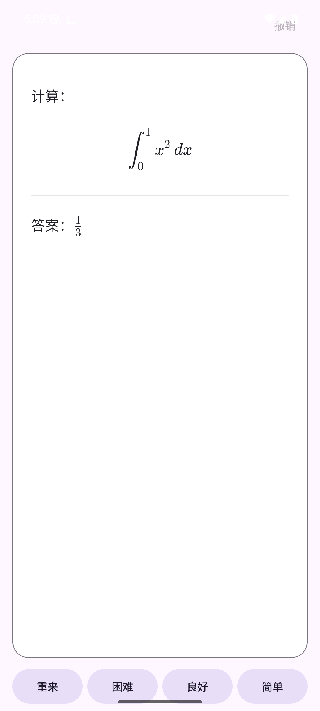

# 原生 Android 迁移（2026-10-22）

Android 主实现迁入 `native-android/`，使用 Kotlin + Jetpack Compose。移除安装包对 Flutter 引擎和 Dart AOT 的依赖，保留原 Flutter 源码作迁移参考。后端接口、FSRS 规则和线上学习数据不变。

## 包体实测

同一固定签名，release、代码优化与资源裁剪开启；以下为 APK 文件大小，单位为十进制 MB。

| 包 | 字节 | MB |
| --- | ---: | ---: |
| Flutter arm64，原 build 8 | 20,908,738 | 20.91 |
| Flutter arm64，分离调试信息 | 19,925,698 | 19.93 |
| 原生 arm64-v8a，build 9 | 2,244,295 | 2.24 |
| 原生 armeabi-v7a，build 9 | 2,241,453 | 2.24 |
| 原生 x86_64，build 9 | 2,244,956 | 2.24 |

相较已分离调试信息的 Flutter arm64 包减少约 **88.7%**，相较原包减少约 **89.3%**。ZIP 检查确认没有 `libflutter.so`、`libapp.so` 或 Flutter assets；arm64 包仅包含约 10 KB 的 `libandroidx.graphics.path.so`。公式使用系统 WebView，字体与样式仍从原后端加载；不捆绑浏览器或整套离线词库。

三个架构分别构建，不生成或发布通用包。CI 的产物名称沿用旧版规则，已有客户端可以在后续新版本发布后选择匹配架构。

## 功能与兼容性

- 保留牌组列表、刷新、首页统计和图标；复习页不显示剩余额度或底部加载条。卡片四个圆角的边框绘制在内容上方。
- 同一队列最多消费 20 次评分或缓存 2 分钟；评分成功后优先本地切卡，退出复习才刷新首页。学习卡到期、学习提前窗口、后台返回、设置版本变化、撤销、空队列均重新对齐服务端。不在客户端计算 FSRS，不自动重发评分或撤销 POST。
- 保留手动、立即和延迟显示答案；内容与字体就绪后计时，后台暂停，手动翻面取消倒计时。学习时长不计入等待渲染和后台时间；旧访问的回调不会影响新卡。
- 英日词卡、完整用法分组和保守释义去重沿用既有规则。日语不展示罗马音；自定义 `plain` 笔记保持原文，不追加词库内容。每个词最多三个 sense、各两个例句。
- 公式调用原 `/api/content/preview`，同一 WebView 保留正反面 DOM，翻面不再重新请求。用 `document.fonts.ready` 与绘制帧确认字体完成；随机 nonce 的固定脚本、CSP、同源资源限制、禁用文件访问与导航。失败时保留原文和手动复习，暂停自动行为，可手动重试。
- 数学语法沿用后端：`\(...\)`、`\[...\]`、`$$...$$`；单个 `$...$` 保持普通文本。
- Media3 按卡面、position 顺序播放音频；语音音频属性、系统焦点、耳机拔出、切卡、后台和退出均受控。短暂失去焦点后停止并释放播放器，焦点恢复不会突然续播；错误后可手动重试。
- 全局时区只提交 `/settings` 的 timezone；牌组弹窗保存差量字段，取消自动翻面显式提交 null。保存失败保留草稿，外部点击关闭、内部点击保留，退出未保存修改需确认。
- 保留 FSRS 参数与训练状态、门槛检查和前台轮询。只在手动操作时开始训练，不重建日程。
- 更新检查仍读取 GitHub 最新正式 Release，验证版本与仓库地址，忽略草稿、预发布及旧版，使用浏览器下载对应架构 APK。
- 保留默认竖屏、系统深浅主题和字体缩放。release 使用 HTTPS，debug 允许本机 HTTP 测试服务器。

## 覆盖升级

正式包名仍为 `com.rethinkos.flashnext_app`，版本读取根目录 `pubspec.yaml`，当前 `0.2.0+9`。build 8 用于此前本地验证，因此原生构建使用 9；本次没有新建 tag 或替换已有 Release。

固定签名 SHA-256：`f81ff936bd1e69c4f571fb0eec392bd198aa83ecff53050177fc9708045ee82f`，已用 apksigner 验证一致。debug 包名增加 `.native`，可与正式版并存。

初次启动兼容读取 `FlutterSharedPreferences` 内的 `flutter.baseUrl`；后续保存使用原生偏好存储。学习进度和设置原本保存在后端，无需迁移。

已在 Android 15 x86_64 模拟器安装 GitHub v0.2.0 Flutter 包（versionCode 7），保留旧偏好文件，再直接 `adb install -r` 原生 release（versionCode 9），成功启动，设置界面正确显示旧版保存的 `https://mem.home.rethinkos.com:443`。未清除应用数据或更换签名。

## 验证

- 14 项 JVM 测试通过：队列缓存、学习到期、后台与内容就绪计时、立即背面、失效回调、撤销失败降级、评分失败、设置 null 与差量、API 编码兼容、预览缓存、更新来源校验、读音和原文字段保留。
- Android 15 模拟器 5 项设备测试通过：复习评分到完成及撤销、弹窗内外点击与未保存草稿、音频顺序与手动停止、短暂焦点丢失后不续播、真实 KaTeX 正反面渲染。
- 公式测试通过仅允许 `POST /api/content/preview` 和读取公式资源的本机桥接访问原后端，检查正反面 `.katex` 节点、字体错误状态、隐藏答案和评分可用状态，并检查截图。所有评分、撤销、设置写入均针对本机 MockWebServer。
- Android Lint 无错误；保留的警告包括锁定竖屏（用户要求）、固定依赖版本和 KTX 风格建议。Compose BOM 固定 `2026.03.00` 以匹配 compileSdk 36；最新 BOM 需要 SDK 37，不混用。
- 三个 release 架构构建通过；apksigner、版本号、包名、ABI 与无 Flutter 库检查通过；工作流通过 actionlint。
- Redmi K60 原无线调试端口 41543 已关闭，本轮真机验证待重新连接。

公式和圆角边框的模拟器截图：



## 复现命令

```sh
native-android/gradlew -p native-android testDebugUnitTest lintDebug assembleRelease
native-android/gradlew -p native-android connectedDebugAndroidTest
```

真实字体测试需要启动原有只读桥接；默认设备测试会跳过需要该桥接的单项，其余测试使用本机 mock，不依赖生产服务：

```sh
node tool/study_preview_proxy.mjs
adb reverse tcp:18765 tcp:18765
native-android/gradlew -p native-android connectedDebugAndroidTest '-Pandroid.testInstrumentationRunnerArguments.previewServer=http://127.0.0.1:18765'
```

Windows 使用 `native-android/gradlew.bat`。APK 位于 `build/native/app/outputs/apk/release/`。GitHub Actions 保存三个 APK、SHA256SUMS 和独立 R8 mapping Artifact，手动运行不创建 Release；新 tag 才发布，禁止覆盖已有 Release。
